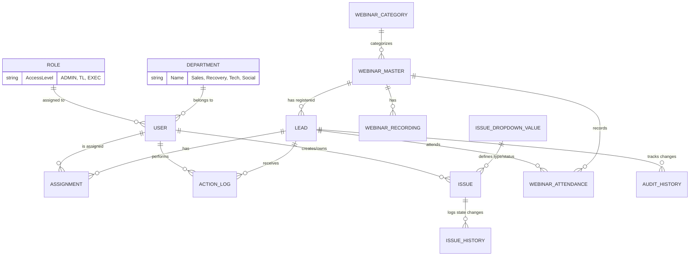

# VS CRM - Overall Project Documentation

## 1. Project Overview
**VS CRM** is a comprehensive Customer Relationship Management (CRM) system built specifically to manage leads, user assignments, webinars, payments, and issues across various departments within the organization. 

It handles workflows for multiple departments:
- **Sales**
- **Recovery**
- **Technical**
- **Social Media**

## 2. Technology Stack
- **Frontend & Framework**: Next.js (App Router), React, Tailwind CSS
- **Database & ORM**: PostgreSQL (via `pg`), Prisma ORM
- **Authentication**: Database-backed opaque sessions with `bcryptjs` password hashing
- **Data Visualization**: Recharts
- **Icons**: Lucide React
- **Other Utilities**: `nodemailer` (emailing), `papaparse` (CSV processing), `react-tailwindcss-datepicker` (date picking)

## 3. Key Entities & Database Schema (Prisma)
The database structure revolves around a few key domain models:

- **User**: Represents team members (Roles: `TL`, `EXEC`). Can belong to different departments and sub-teams.
- **Lead**: Core entity representing a customer or prospect. Tracks payments, status, webinar attendance, custom dynamic data, and assignments.
- **Assignment**: Maps Leads to Users (many-to-many via explicit relation) tracking the stage of engagement.
- **ActionLog**: Audit logs and call action updates performed by Users on Leads.
- **WebinarMaster / WebinarAttendance / WebinarCategory**: Systems for tracking webinars, attendees, and recordings.
- **Issue / IssueHistory**: Ticketing system to track technical or other issues raised for leads by users.

## 4. Architecture & Data Flow Diagram

The following Mermaid diagram provides a high-level view of the entity relationships and architecture.

### Module Structure
- `/src/app`: Contains the Next.js App Router definitions. Folders represent route segments (e.g., `/sales`, `/login`, `/recovery`, `/technical`, `/analytics`).
- `/src/components`: Reusable UI components (Tables, Modals, Forms, Charts).
- `/src/utils`: Helper functions, constants, formatting scripts.
- `/prisma`: Contains `schema.prisma` mapping the database and migration files.

## 5. Role-Based Access Control (RBAC) & Departments
The system enforces strict access control rules based on a combination of a user's **Role** and **Department**.

### Roles
- **ADMIN**: Full system access. Can manage users, create custom columns, configure dropdown values, and view all system analytics and leads without restrictions.
- **TL (Team Leader)**: Has managerial oversight over their department. They can view team performance dashboards, access their team's lead queues, and manage settings pertinent to their department.
- **EXEC (Executive)**: Standard operational role. Can only view and act upon leads assigned specifically to them, access their personal performance metrics, and operate within their designated queues.

### Departments & Cross-Department Restrictions
Users are segmented into various departments such as **Sales Department**, **Social Media**, **RECOVERY**, and **TECHNICAL**.
- Route middleware and proxies ensure that users (unless they are `ADMIN`) can only access pages and features relevant to their assigned department. 
- For instance, an `EXEC` in `Social Media` cannot navigate to the `Sales` portal or `Recovery` queue, enforcing strong departmental isolation.

## 6. Main Features
1. **Lead Tracking**: Follow-up dates, call statuses (Untouched, Connected), lead status (In Progress, Closed), and detailed payment logs.
2. **Issue Management**: Logging, assigning, and resolving issues linked to specific leads or operations.
3. **Analytics & Performance Tracking**: Dashboard and performance graphs (via `recharts`) showing conversions and activities over time.
4. **Dynamic Columns**: A system (`CustomColumn` in DB) supporting custom form fields depending on department targets.

## 6. Scripts & Operations
From the `package.json`, standard Next.js operations apply:
- `npm run dev`: Starts the local development server.
- `npm run build`: Compiles the application for production.
- `npm run start`: Runs the compiled production application.

Various seeding and maintenance scripts exist (e.g., `clean-db.ts`, `seed-leads.ts`, `migrate-webinars.js`) to manage local state and database changes.
